<div align="center">

<a href="https://ciautomatiza.com.br/dev/portfolio"></a>

<br>

<a href="https://ciautomatiza.com.br/dev/portfolio">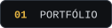</a>
<a href="#ecossistema">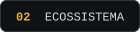</a>
<a href="#projetos">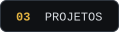</a>
<a href="#stack">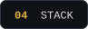</a>
<a href="#lab">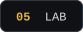</a>
<a href="#contato">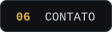</a>
<a href="#english">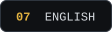</a>

<br><br>


</div>


## Sobre

```json
{
  "nome": "Eduardo Bottino",
  "idade": 24,
  "pais": "Brasil",
  "papel": [
    "Desenvolvedor Full-Stack",
    "CEO e Dev @ C.IAutomatiza",
    "CTO e Dev @ PixelCraft Studio",
    "Dev @ Studio Codex"
  ],
  "formacao": "Análise e Desenvolvimento de Sistemas (ADS), cursando",
  "foco": ["automação", "cybersecurity", "APIs", "jogos", "comunidades"]
}
```

Sou **Eduardo Bottino**, desenvolvedor full-stack e estudante de **ADS**. Comecei com automações e chatbots e hoje sou **CEO da [C.IAutomatiza](https://ciautomatiza.com.br)** e **CTO da [PixelCraft Studio](https://pixelcraft-studio.com/)**, além de desenvolver no **Studio Codex**. Em volta dessas frentes mantenho projetos internos e externos, todos com o mesmo objetivo: **automatizar, conectar e fazer pessoas e negócios crescerem**.

Gosto de jogar, explorar tecnologias novas e caçar bugs e comportamentos inesperados.


## Ecossistema

<div align="center">
  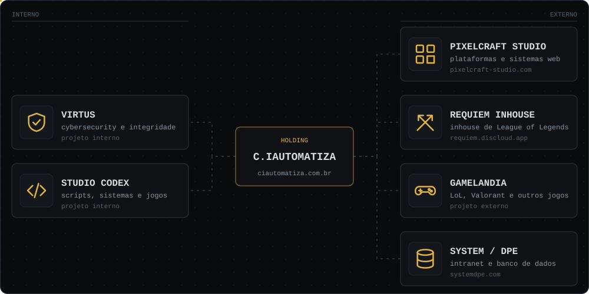
</div>

<br>

- **[C.IAutomatiza](https://ciautomatiza.com.br)**: holding do ecossistema. Automação inteligente, SaaS e segurança.
- **Internos da C.IA**: **VIRTUS** (cybersecurity) e **Studio Codex** (scripts, sistemas, jogos e plataformas de API).
- **Externos**: **[PixelCraft Studio](https://pixelcraft-studio.com/)**, **[REQUIEM Inhouse](https://requiem.discloud.app)**, **Gamelandia** e **System / DPE** ([dpe-system.discloud.dev](https://dpe-system.discloud.dev) · [systemdpe.com](https://systemdpe.com)).


## Projetos

### Empresas

<a href="https://ciautomatiza.com.br">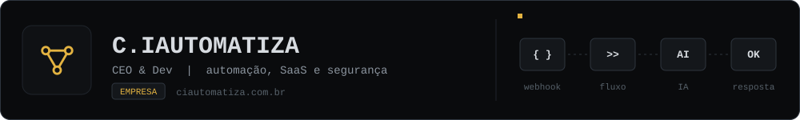</a>

A empresa-mãe do ecossistema. Nasceu com chatbots e com o SaaS **NeuralFlow** (pré-atendimento, captação de leads e fluxos automatizados de WhatsApp) e hoje reúne automação, produtos digitais e os projetos internos **VIRTUS** e **Studio Codex**.

`Automação` `SaaS` `WhatsApp` `Dashboards` `APIs` `Cybersecurity`

<a href="https://ciautomatiza.com.br"></a>
<a href="https://ciautomatiza.com.br/dev/portfolio"></a>

<br>

<a href="https://pixelcraft-studio.com/">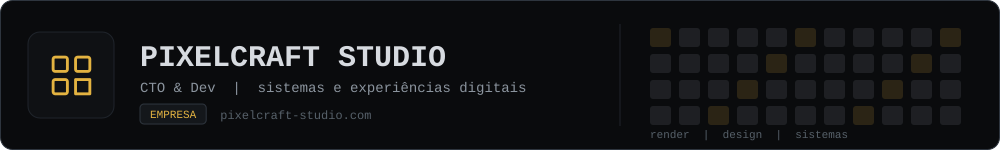</a>

Estúdio focado em desenvolver para servidores de jogos como Minecraft, Ragnarok, Mu, Metin 2, Hytale, GTA e muito mais!

`Discord` `Web` `Tickets/SAC` `Dashboards` `UX`

<a href="https://pixelcraft-studio.com/"></a>

### Projetos internos da C.IA

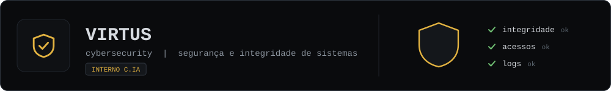

Sistema de **cybersecurity** da C.IAutomatiza, pensado para a **segurança e a integridade de sistemas**.

`Cybersecurity` `Integridade` `Sistemas`

<br>


Onde produzimos **scripts, sistemas, sites, plataformas de produção para APIs**, além das ferramentas úteis para os demais projetos do seu ecossistema.

`Scripts` `APIs` `Jogos` `Ferramentas`

### Projetos externos

<a href="https://requiem.discloud.app"></a>

**REQUIEM Inhouse**: sistema de inhouse e comunidade personalizada de **League of Legends**. O ecossistema é integrado à **Riot API** para coletar dados do jogo e entrega à comunidade um ecossistema de; **BOT para Discord**, um **Launcher/APK** e um **site** com métricas, dados e partidas em tempo real com **lobbies personalizados**, sempre com foco em crescer, evoluir e se divertir de forma organizada em uma comunidade especializada.

`League of Legends` `Riot API` `Bot` `Launcher` `Dashboard`

<a href="https://requiem.discloud.app"></a>

<br>


Projeto que leva vários BOT's e Aplicativos no Discord. Temos atualmente 3 sistemas integrados em nosso servidor para que a comunidade possa usufruir e aproveitar. Os jogos são compostos por painéis, imagem e interação em chat no Discord. Para os amantes de Pokémon, o **PokeMod** é ideal para quem gosta de colecionar cartas ou explorar nossas arenas e batalhar contra outros pokemons e outras equipes. Para os amantes de jogatinas, o **GameMod** é composto por mais de 10 minigames como; Batalha-naval, jogo da velha, dominó, jogos de cartas e muitos outros para se divertir em nossa comunidade. Acesse agora a comunidade e venha se divertir!

`Riot API` `League of Legends` `Valorant` `Comunidade`

<br>

<a href="https://systemdpe.com">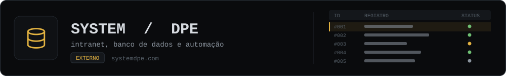</a>

Sistema profissional e moderno de **intranet completa**, com banco de dados e automatização, desenvolvido para o **DPE (Departamento Policial de Elite)**, uma polícia no jogo **Habbo Hotel**. Utilizando API's e uma Engine, os usuários podem utilizar o sistema para suas atividades do cotidiano de forma automatizada e organizada com uma base e infraestrutura vinculada ao Site, API do jogo, Discord, Telegram e uma Engine pessoal.

`Intranet` `Banco de dados` `Automação` `Habbo Hotel`

<a href="https://dpe-system.discloud.dev"></a>
<a href="https://systemdpe.com">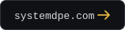</a>


## Stack

<div align="center">
  
</div>


## Lab

Console, builds e minigames. Tudo aqui é **SVG puro, feito à mão em código**, sem JavaScript e sem serviço externo: abre direto no GitHub, em qualquer navegador.

### Console de desenvolvimento

<div align="center">
  
</div>

### Construções

<div align="center">
  
</div>

### Minigames

<div align="center">
  
  <br><br>
  
</div>


## Contato

<div align="center">

Quer conversar ou montar um projeto? Manda um sinal.

<br>

<a href="mailto:contatobottino@gmail.com"></a>
<a href="https://ciautomatiza.com.br/dev/portfolio"></a>

<a href="https://github.com/eoBottino">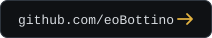</a>
<a href="https://www.instagram.com/edubottino/">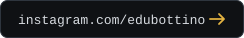</a>
<a href="https://discord.com/users/784213910180986900">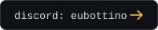</a>

</div>


## English

<details>
<summary><b>Click to expand the English version</b></summary>

<br>

I'm **Eduardo Bottino**, 24, from **Brazil**: a **full-stack developer** and a student of **Systems Analysis and Development (ADS)**. I'm the **CEO and developer at [C.IAutomatiza](https://ciautomatiza.com.br)** (automation, SaaS and security; it started with chatbots and the NeuralFlow SaaS), the **CTO and developer at [PixelCraft Studio](https://pixelcraft-studio.com/)** (modern platforms and digital experiences), and a developer at **Studio Codex**.

**Internal projects (C.IAutomatiza)**

- **VIRTUS**: cybersecurity system focused on systems security and integrity.
- **Studio Codex**: scripts, systems, games, API production platforms and tools for the other projects.

**External projects**

- **[REQUIEM Inhouse](https://requiem.discloud.app)** (formerly ARISE Inhouse): an inhouse system and custom League of Legends community, built on the Riot API, with a Bot, a Launcher and a website with metrics, data and real-time custom lobbies.
- **Gamelandia**: the same Riot API ecosystem applied to League of Legends, Valorant and other games.
- **System / DPE** ([dpe-system.discloud.dev](https://dpe-system.discloud.dev) · [systemdpe.com](https://systemdpe.com)): a complete intranet with database and automation, built for the DPE (Elite Police Department), a police force in Habbo Hotel.

**Portfolio:** [ciautomatiza.com.br/dev/portfolio](https://ciautomatiza.com.br/dev/portfolio)

</details>

<br>

